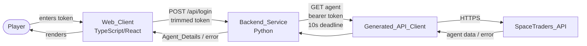
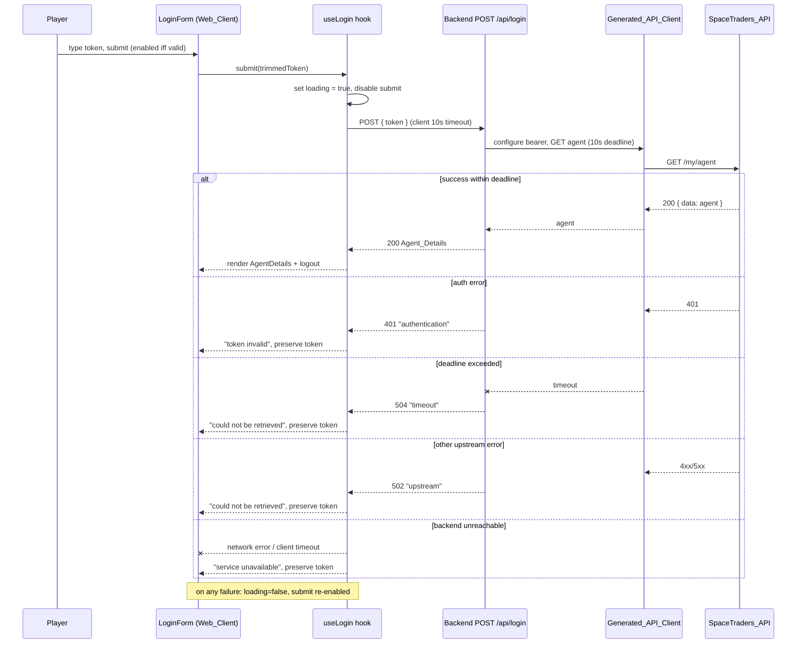
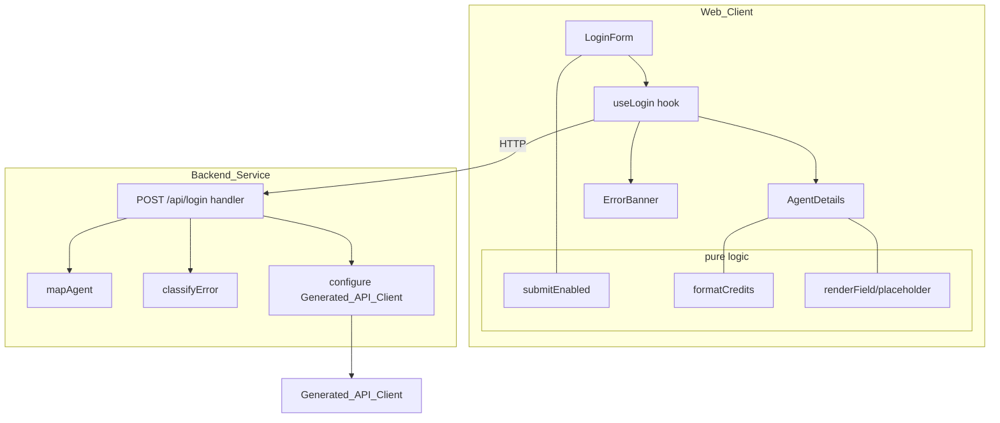

# Design Document

## Overview

The agent-login feature is the first, deliberately stateless iteration of a SpaceTraders web client. A player pastes their SpaceTraders API token into a login form; the frontend (Web_Client) forwards the trimmed token to a thin Python backend (Backend_Service); the backend configures a freshly instantiated Generated_API_Client with the token as a bearer credential, calls the SpaceTraders_API agent endpoint under a 10-second deadline, maps the response to a compact Agent_Details shape, and returns it. The Web_Client renders the six agent fields and offers a logout control. Nothing is persisted anywhere — not the token, not the agent data — on either side.

The design optimizes for three things: statelessness (no storage of credentials or data, per-request token flow), a crisp error contract (every failure maps to one of four user-facing messages derived from a small set of backend status codes), and a reproducible, type-accurate API client generated from the official OpenAPI specification.

### Research Notes

- **SpaceTraders authentication model.** The SpaceTraders_API authenticates every request with a bearer token in the `Authorization` header. The agent for the authenticated token is retrieved from the `GET /my/agent` operation, which returns an envelope `{ "data": { ...agent } }`. The agent payload carries `accountId`, `symbol` (the call sign), `headquarters`, `credits`, `startingFaction`, and `shipCount`. `credits` is a signed integer that can be large (SpaceTraders documents a 64-bit-ish range); the requirement constrains display to the base-10 integer range −999,999,999,999..999,999,999,999. Source: SpaceTraders API docs and OpenAPI spec at https://spacetraders.io/openapi. Content was rephrased for compliance with licensing restrictions.
- **OpenAPI Generator for Python.** The official `openapi-generator-cli` produces a typed Python client (models + API classes) from an OpenAPI document. The `python` generator emits a configurable client whose configuration object accepts an `access_token` (bearer) that it attaches to requests. Pinning the generator version is required for reproducible output; the generator exits non-zero and writes nothing to the output tree when the input spec fails validation. Source: OpenAPI Generator documentation. Content was rephrased for compliance with licensing restrictions.
- **Per-request deadlines.** The generated Python client is built on `urllib3`; a request timeout can be supplied per call (or via the client configuration), which lets the backend enforce the 10-second upstream deadline and translate expiry into a dedicated timeout outcome rather than a generic failure.
- **Browser statelessness.** React in-memory state (component state / a hook) is volatile and cleared on reload. Avoiding `localStorage`, `sessionStorage`, `document.cookie`, and `IndexedDB` entirely guarantees nothing survives a reload, satisfying the stateless requirement without extra cleanup logic.

### Key Design Decisions

- **Thin, stateless backend endpoint (`POST /api/login`).** The token arrives in the request body, is used to configure a client instance scoped to that single request, and is discarded when the handler returns. No module-level or process-wide client holds the token. This directly serves Requirement 5 (no persistence) and Requirement 2 (per-request bearer call).
- **Centralized error classification.** A single function maps any upstream result into one of `authentication → 401`, `timeout → 504`, `upstream → 502`. The handler never builds status codes ad hoc, which keeps the error contract (Requirement 4) consistent and testable, and makes redaction (never echoing the token) a single choke point.
- **Deadline owned by the backend.** The 10-second limit on the SpaceTraders call lives in the backend (Requirement 2.5). The frontend keeps its own independent 10-second guard (Requirement 3.4) so a hung or unreachable backend still yields a user-visible outcome.
- **Pure, isolated logic for the parts that matter.** Submit-enable evaluation, token trimming, credits formatting, agent mapping (including the ship-count floor), field placeholder rendering, and error classification are all written as pure functions. This makes them directly amenable to property-based testing and keeps the React components and the Flask/FastAPI handler thin.
- **Generated client is a build artifact, not hand-edited source.** The client is produced by a single pinned, documented command (a `make` target). The generated output is treated as read-only; regeneration never requires manual edits (Requirement 6).

## Architecture

### System context



### Login request flow (happy path and failures)



### Component layers



## Components and Interfaces

### Frontend (Web_Client)

- **LoginForm** — Renders the single token `<input>` and the submit control. Computes the submit-enable state from the current input via the pure `submitEnabled` predicate, shows the max-length validation message when the token exceeds 4096 characters, and shows the loading indicator while a request is in flight. On submit it passes the trimmed token to `useLogin`. The entered token is preserved across failures (controlled input value lives in hook state).

- **AgentDetails** — Renders the six fields (account identifier, call sign, headquarters, credits, starting faction, ship count). Uses `formatCredits` for the credits value and a field-rendering helper that substitutes a placeholder for any absent/null field. Renders the logout control while details are displayed.

- **ErrorBanner** — Displays the current error message (token invalid / could not be retrieved / service unavailable) and, for the client-side timeout case, a retry control.

- **useLogin hook** — Owns all session state in memory:
  ```ts
  type LoginStatus = 'idle' | 'loading' | 'success' | 'error';

  interface UseLogin {
    token: string;                 // controlled input value (preserved on failure)
    status: LoginStatus;
    agent: AgentDetails | null;
    error: LoginError | null;
    setToken(next: string): void;
    submitEnabled: boolean;        // derived via pure predicate
    submit(): Promise<void>;       // sends trimmed token exactly once per call
    retry(): Promise<void>;
    logout(): void;                // clears token + agent from memory
  }
  ```
  `submit` trims the token, sends exactly one request, enforces a 10-second client timeout (via `AbortController`), maps the response/failure to a `LoginError`, and on any failure clears `loading` and re-enables submit for non-empty tokens. No storage API is ever touched.

- **Pure logic modules**
  - `submitEnabled(raw: string): boolean` → `trim(raw).length >= 1 && raw.length <= 4096`.
  - `formatCredits(n: number): string` → base-10 integer string, no fractional separator.
  - `fieldOrPlaceholder(value): string` → the value's display string, or the placeholder when null/absent.
  - `classifyResponse(status, networkError): LoginError` → maps HTTP 401 → token-invalid, 502/504 → could-not-retrieve, network/client-timeout → service-unavailable.

### Backend (Backend_Service)

- **`POST /api/login` handler** — Accepts `{ "token": string }`. Instantiates a fresh Generated_API_Client configuration with the token as the bearer credential, invokes the agent operation with a 10-second deadline, maps success to `Agent_Details` (HTTP 200), and routes every failure through `classify_error`. Never logs the token or the agent payload.
  - Request: `{ "token": "<agent token>" }`
  - Success response (200): the `Agent_Details` JSON (see Data Models).
  - Error response (401/502/504): `{ "error": { "kind": "authentication|timeout|upstream", "message": "<redacted human message>" } }`.

- **`map_agent(upstream) -> AgentDetails`** — Pure mapping. Copies `accountId`, `symbol`, `headquarters`, `credits`, `startingFaction` (null-preserving) and sets `shipCount = max(0, reported)`.

- **`classify_error(outcome) -> (status, kind, message)`** — Pure classifier. Authentication outcome → `(401, "authentication")`; deadline/timeout outcome → `(504, "timeout")`; any other upstream failure → `(502, "upstream")`. The produced message never contains the token; as defense-in-depth it also redacts any occurrence of the token substring.

- **Generated_API_Client wiring** — A small adapter configures the generated client's configuration object with the per-request bearer token and the request timeout, then calls the agent operation. The adapter is the only place that touches the generated client, keeping the handler decoupled from generator-specific types.

## Data Models

### Agent_Details (backend response / frontend model)

| Field            | Type              | Notes |
|------------------|-------------------|-------|
| `accountId`      | string \| null    | Account identifier, copied from upstream. |
| `symbol`         | string \| null    | Call sign, copied from upstream. |
| `headquarters`   | string \| null    | Copied from upstream. |
| `credits`        | integer \| null   | Signed base-10 integer, display range −999,999,999,999..999,999,999,999. |
| `startingFaction`| string \| null    | Copied from upstream. |
| `shipCount`      | integer           | `max(0, reported)`; never negative. |

TypeScript shape:
```ts
interface AgentDetails {
  accountId: string | null;
  symbol: string | null;
  headquarters: string | null;
  credits: number | null;
  startingFaction: string | null;
  shipCount: number; // >= 0
}
```

### LoginRequest

```ts
interface LoginRequest { token: string; } // trimmed, 1..4096 non-whitespace chars
```

### LoginError (frontend)

```ts
type LoginErrorKind = 'token-invalid' | 'could-not-retrieve' | 'service-unavailable';
interface LoginError { kind: LoginErrorKind; message: string; }
```

### Backend error envelope

```json
{ "error": { "kind": "authentication|timeout|upstream", "message": "<redacted>" } }
```

## Correctness Properties

*A property is a characteristic or behavior that should hold true across all valid executions of a system — essentially, a formal statement about what the system should do. Properties serve as the bridge between human-readable specifications and machine-verifiable correctness guarantees.*

### Property 1: Submit-enable predicate

*For any* input string `s`, the submit control is enabled if and only if `s` contains at least one non-whitespace character and the total length of `s` is at most 4096.

**Validates: Requirements 1.2, 1.3, 1.6**

### Property 2: Submission sends the trimmed token exactly once

*For any* valid token (1..4096 non-whitespace characters, possibly surrounded by whitespace), submitting the form sends exactly one Login_Request whose body equals the whitespace-trimmed token.

**Validates: Requirements 1.4**

### Property 3: Credits formatting round-trip

*For any* integer `n` in the range −999,999,999,999..999,999,999,999, `formatCredits(n)` produces a base-10 string with no fractional separator, and parsing that string back yields exactly `n`.

**Validates: Requirements 3.2**

### Property 4: Agent mapping preserves fields and floors ship count

*For any* upstream agent payload, `map_agent` preserves `accountId`, `symbol`, `headquarters`, `credits`, and `startingFaction` exactly (including null values) and produces `shipCount = max(0, reportedShipCount)`.

**Validates: Requirements 2.3, 2.4**

### Property 5: Missing fields render placeholders, present fields render values

*For any* Agent_Details value, each field that is null or absent renders the placeholder indicator and each field that is present renders its value.

**Validates: Requirements 3.3**

### Property 6: Upstream outcomes map to the correct HTTP status

*For any* upstream outcome, `classify_error` returns HTTP 401 when the outcome is an authentication error, HTTP 504 when the outcome is a deadline/timeout, and HTTP 502 for any other upstream error.

**Validates: Requirements 4.1, 4.2, 2.5**

### Property 7: Error responses never contain the token

*For any* token and any failure outcome, the serialized backend error response does not contain the token as a substring.

**Validates: Requirements 4.1, 4.2**

### Property 8: Any failure restores a usable form

*For any* failure outcome, after the Login_Request settles the loading indicator is cleared and the submit control is re-enabled for any non-empty token.

**Validates: Requirements 4.6**

## Error Handling

- **Backend classification (single choke point).** Every path out of the handler that is not a 200 flows through `classify_error`:
  - SpaceTraders authentication rejection → **401** `authentication`.
  - Upstream deadline exceeded (10s) → **504** `timeout`, no Agent_Details.
  - Any other upstream error (non-401 HTTP error, connection failure to SpaceTraders, malformed payload) → **502** `upstream`.
  - Error messages are human-readable and token-free; the token substring is additionally scrubbed from any message as defense-in-depth. Neither token nor agent data is logged.
- **Frontend mapping.** `classifyResponse` turns transport results into user messages:
  - HTTP 401 → "Your token is invalid." (Requirement 4.3), token preserved.
  - HTTP 502 / 504 → "Agent details could not be retrieved." (Requirement 4.4), token preserved, retry available for the client-timeout case.
  - Backend unreachable / client-side 10s timeout → "The service is unavailable." (Requirement 4.5), token preserved.
  - On every failure: loading cleared, submit re-enabled for non-empty tokens (Requirement 4.6).
- **Client-side timeout.** `useLogin` aborts the request at 10 seconds and shows the could-not-retrieve message with a retry control (Requirement 3.4), independent of the backend's own deadline.

## Testing Strategy

The strategy is dual: property-based tests verify universal behavior of the pure logic, while example/unit, integration, smoke, and end-to-end tests cover concrete scenarios, wiring, configuration, and full user flows.

### Property-based tests

- **Frontend:** `fast-check`. **Backend:** `Hypothesis`.
- Minimum **100 iterations** per property test.
- **One property-based test per correctness property.**
- Each test is tagged with a comment: **Feature: agent-login, Property {number}: {property_text}**.

| Property | Location | Library | Generators |
|----------|----------|---------|------------|
| 1 Submit-enable predicate | frontend | fast-check | arbitrary strings incl. whitespace-only, empty, lengths around 4096 |
| 2 Trimmed, exactly-once submission | frontend | fast-check | valid tokens padded with arbitrary whitespace; transport spy |
| 3 Credits formatting round-trip | frontend | fast-check | integers across full −999,999,999,999..999,999,999,999 range + boundaries |
| 4 Agent mapping preserves fields, floors ship count | backend | Hypothesis | upstream payloads with optional/null fields and arbitrary (incl. negative) ship counts |
| 5 Placeholder vs value rendering | frontend | fast-check | Agent_Details with random null subsets |
| 6 Status mapping | backend | Hypothesis | upstream outcomes: auth, deadline, assorted other errors |
| 7 Token never in error body | backend | Hypothesis | arbitrary tokens × failure outcomes |
| 8 Failure restores usable form | frontend | fast-check | arbitrary failure kinds driving the hook |

### Example / unit tests

- Login form renders a single token input and submit control with no active session (1.1).
- Loading indicator shown and submit disabled while a request is pending (1.5).
- Client timeout at 10s surfaces the could-not-retrieve message plus a retry control (3.4).
- Each `LoginError` kind maps to its exact message string and preserves the entered token (4.3, 4.4, 4.5).

### Integration tests (SpaceTraders_API / Generated_API_Client mocked)

- Backend configures the generated client with the bearer token and calls the agent endpoint (2.1, 6.4).
- Success within the deadline returns Agent_Details with HTTP 200 (2.2).
- Malformed OpenAPI spec fixture: generation aborts non-zero, does not overwrite the existing client, emits an invalid-spec error (6.3).

### Smoke tests

- Generation command/config exists and runs against a valid fixture spec, producing the expected client modules (6.1, 6.2).
- The single documented regeneration command (make target) runs end-to-end with no manual edits (6.5).
- Backend processes a login with spied logger and storage layers and performs no writes of token or agent data (5.1, 5.2); frontend spies on `localStorage`/`sessionStorage`/`cookie`/`IndexedDB` and asserts none are called (5.3).

### End-to-end testing

End-to-end tests use **Playwright** to drive full user-facing flows against the running Web_Client and Backend_Service, with the SpaceTraders_API mocked/stubbed at the network boundary (so the generated client talks to a controllable fake). Coverage at minimum:

- **Successful login:** a valid token leads to the agent details rendering with all six fields and a logout control (1.1, 1.5, 3.1, 3.5).
- **Logout clears state:** activating logout returns to an empty login form; a fresh page load also shows an empty form with no agent data (5.4, 5.5).
- **Invalid token:** an upstream 401 yields the "token invalid" message with the entered token preserved in the form (4.3).
- **Upstream / timeout failures:** backend 502 and 504 responses yield the "could not be retrieved" message with the token preserved (4.4).
- **Backend unreachable:** when the backend cannot be reached, the client shows the "service unavailable" message (4.5).

## Client Generation

- **Tool and source.** The Generated_API_Client is produced by the official `openapi-generator-cli` using its **python** generator, from the SpaceTraders OpenAPI specification at https://spacetraders.io/openapi (6.1).
- **Pinned version.** The generator version is pinned (e.g., a fixed `openapi-generator-cli` release) so output is reproducible across machines and over time.
- **Single repeatable command.** Regeneration is a single documented command — a `make` target, e.g. `make generate-client` — that downloads/validates the spec and runs the generator with pinned options, requiring no manual edits to the generated output (6.5). The generated tree is treated as read-only build output.
- **Completeness.** Run against a valid spec, the command produces models and API operations for every endpoint and schema in that specification (6.2).
- **Failure behavior.** If the spec is malformed or fails schema validation, the command aborts with a non-zero exit status, does not overwrite the existing Generated_API_Client, and emits an error indicating the specification is invalid (6.3). This is achieved by generating into a temporary location and only swapping it into place after the generator succeeds.
- **Usage.** The Backend_Service calls the SpaceTraders_API agent endpoint exclusively through the Generated_API_Client, configuring the per-request bearer token on a fresh client configuration (2.1, 6.4).
