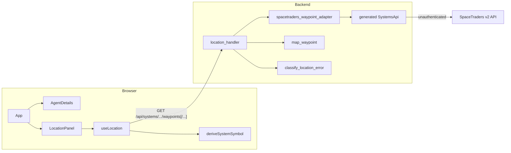
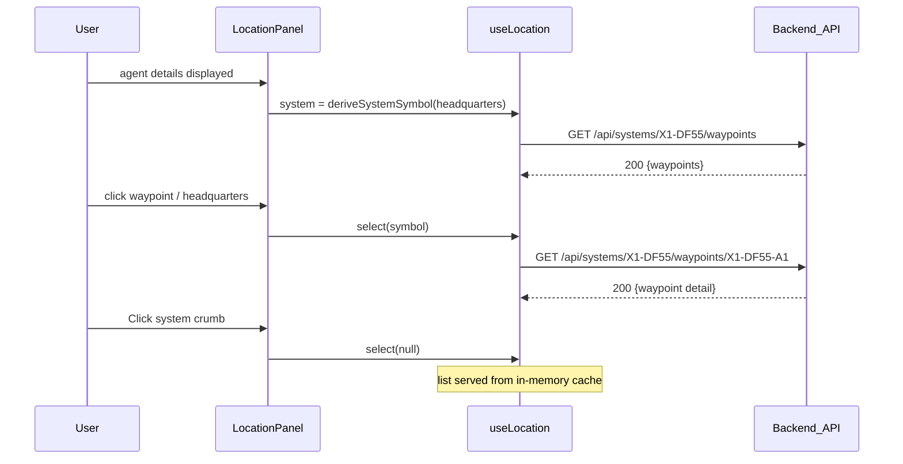

# Design Document

## Overview

After login, the headquarters value in the Agent_Details_View becomes a button. Activating it selects that waypoint and shows its details in a Location_Panel column beside the agent details. With nothing selected, the panel lists every waypoint in the agent's system.

The change has two halves:

- **Backend.** Two new unauthenticated routes, `GET /api/systems/{systemSymbol}/waypoints` and `GET /api/systems/{systemSymbol}/waypoints/{waypointSymbol}`. They call the generated client's `SystemsApi.get_system_waypoints` and `SystemsApi.get_waypoint` through a new adapter, map the upstream models to compact response shapes, and convert failures to the existing error envelope.
- **Frontend.** A `LocationPanel` component driven by a `useLocation` hook that holds the Selected_Location and caches the Location_List in memory. A pure `deriveSystemSymbol` function turns a waypoint symbol into a system symbol.

### Research findings

- The generated client (`backend/app/generated/spacetraders_client/api/systems_api.py`) has `get_system_waypoints(system_symbol, page, limit<=20, ...)` returning `data: List[Waypoint]` and `meta {total, page, limit}`, and `get_waypoint(system_symbol, waypoint_symbol)` returning `data: Waypoint`. Neither needs a token, so a `Configuration()` with no `access_token` is sufficient, matching `spacetraders_status_adapter.py`.
- The generated `Waypoint` model has `symbol`, `type`, `systemSymbol`, `x`, `y`, `orbitals[]`, optional `orbits`, optional `faction`, `traits[]`, optional `modifiers[]`, optional `chart`, and `isUnderConstruction`. `limit` is capped at 20, which is why Page_Size is 20.
- Existing helpers are reused: `_import_generated` and `_close` from `generated_client_adapter.py`, `ErrorEnvelope` from `models.py`, and the Vite `/api` proxy, which already forwards the new paths.
- `ErrorKind` is currently `authentication | timeout | upstream`. A 404 needs its own kind, so `not_found` is added.

### Key design decisions

| Decision | Rationale |
| --- | --- |
| New `spacetraders_waypoint_adapter.py` rather than extending `generated_client_adapter.py` | The login adapter is token-specific. A separate module follows the `spacetraders_status_adapter.py` precedent and keeps the no-token path obvious. |
| Adapter returns payload dicts or a normalized failure, never raises | Same contract as `fetch_agent`, so handlers stay simple and testable with a stubbed adapter. |
| Add `not_found` to `ErrorKind`; do not reuse `classify_error` for 404 | `classify_error` is token-oriented and maps everything non-401/timeout to 502. A small location-specific classifier maps 404/timeout/other and leaves login behavior untouched. |
| 5-second timeout is per upstream call | Requirements 7.6 and 8.5 say "a call". A paginated list may take several calls, each under 5 seconds. |
| Validate path params with a regex in FastAPI `Path(pattern=...)` | Gives 422 before the handler runs, so the adapter is never called (7.7, 8.6). |
| Cache the Location_List in `useLocation` state keyed by system symbol | Satisfies 5.3 (no refetch on return) with no persistence (10.3). |
| Sort the Location_List in the frontend with a pure `sortWaypointsBySymbol` function, applied at render time | The backend keeps returning upstream order (7.2). Sorting in the frontend keeps the cached list unchanged and lets a later ship-based distance ordering swap in another pure comparator, since the ship position will be frontend state. |
| Derive the system symbol on the frontend with a pure function | Required by 9.3, and keeps the list request independent of any extra backend lookup. |

## Architecture





## Components and Interfaces

### Backend

**`app/spacetraders_waypoint_adapter.py`** (new)

```python
REQUEST_TIMEOUT_SECONDS: float = 5.0
PAGE_SIZE: int = 20

@dataclass(frozen=True)
class WaypointFailure:
    kind: Literal["not_found", "timeout", "upstream"]

def fetch_system_waypoints(system_symbol: str) -> list[dict] | WaypointFailure: ...
def fetch_waypoint(system_symbol: str, waypoint_symbol: str) -> dict | WaypointFailure: ...
```

- Builds `Configuration()` with no `access_token`, builds an `ApiClient`, and closes it in `finally`.
- `fetch_system_waypoints` requests page 1 with `limit=PAGE_SIZE`, reads `meta.total`, then requests pages `2..ceil(total/PAGE_SIZE)` and concatenates `data` in order. Each call passes `_request_timeout=5.0`. Any failure on any page returns a `WaypointFailure` for the whole request.
- Failure mapping from the generated exception: status 404 gives `not_found`; a timeout (reusing the `_looks_like_timeout` check from `generated_client_adapter`) gives `timeout`; anything else, including a missing generated client, gives `upstream`.
- Waypoints are returned as plain dicts (via `to_dict()`) so the mapper has no dependency on generated types.

**`app/map_waypoint.py`** (new, pure)

```python
def map_waypoint_summary(waypoint: Mapping) -> WaypointSummary: ...
def map_waypoint_detail(waypoint: Mapping) -> WaypointDetail: ...
```

Optional upstream fields that are absent map to `None` (or an empty list for `orbitals`, `traits`, `modifiers`).

**`app/location_handler.py`** (new)

```python
SYSTEM_PATTERN = r"^[A-Za-z0-9]+-[A-Za-z0-9]+$"
WAYPOINT_PATTERN = r"^[A-Za-z0-9]+-[A-Za-z0-9]+-[A-Za-z0-9]+$"

@router.get("/api/systems/{systemSymbol}/waypoints")
async def list_waypoints(systemSymbol: str = Path(pattern=SYSTEM_PATTERN)) -> JSONResponse

@router.get("/api/systems/{systemSymbol}/waypoints/{waypointSymbol}")
async def get_waypoint(systemSymbol: str = Path(pattern=SYSTEM_PATTERN),
                       waypointSymbol: str = Path(pattern=WAYPOINT_PATTERN)) -> JSONResponse
```

- Success: HTTP 200 with `{"waypoints": [...]}` or the detail object.
- Failure: `WaypointFailure.kind` maps to 404 / 504 / 502 and an `ErrorEnvelope` with `kind` and a fixed message. Messages contain no request data.
- The router is registered in `main.py` via `app.include_router(location_router)`.
- The adapter functions are synchronous; as with the existing handlers, they are called directly from the route function.
- No logging or storage is added.

**`app/models.py`** (modified): add `WaypointSummary`, `WaypointDetail`, and extend `ErrorKind` with `"not_found"`.

### Frontend

**`logic/deriveSystemSymbol.ts`** (new, pure)

```ts
export function deriveSystemSymbol(waypointSymbol: string): string | null
export function joinWaypointSymbol(systemSymbol: string, suffix: string): string
```

Returns the first two dash-separated segments when the input has exactly three non-empty segments, otherwise `null`.

**`hooks/useLocation.ts`** (new)

```ts
interface UseLocation {
  systemSymbol: string | null;          // null => cannot determine
  selected: string | null;
  list: AsyncState<WaypointSummary[]>;
  detail: AsyncState<WaypointDetail>;
  select(symbol: string | null): void;
  retry(): void;
}
type AsyncState<T> =
  | { status: 'idle' }
  | { status: 'loading' }
  | { status: 'success'; data: T }
  | { status: 'error'; message: string; notFound: boolean };
```

- Takes the agent's `headquarters`. Fetches the list once on mount for the derived system, and stores the result in state. Returning to the list reads the stored result without a request.
- On `select(symbol)` it fetches the detail. Each detail request has a monotonically increasing id and an `AbortController`; a response whose id is not the latest is discarded (4.5).
- Requests use `fetch(url)` with no headers and no `Authorization` (10.1). A 5-second-plus client timeout is not added; the backend enforces upstream deadlines and the existing health hook pattern is not needed here.
- `retry()` repeats whichever request is in the error state.
- State is React state only (10.3).

**`components/AgentDetails.tsx`** (modified): renders `<button type="button" onClick={() => onSelectHeadquarters(hq)}>` for a non-null headquarters, otherwise the existing placeholder.

**`components/LocationPanel.tsx`** (new): renders one of the list, the details, the loading state, or the error state, plus a visually hidden `role="status"` `aria-live="polite"` region for loading and error text (6.5). Errors use `role="alert"` content inside the live region. A `Breadcrumb` renders at the top: `<nav aria-label="Breadcrumb"><ol>` with the system symbol as the first `<li>`. When a location is selected (including the 404 and detail-error states), the system crumb is a `<button type="button">` calling `select(null)` and the second `<li>` holds the selected waypoint symbol with `aria-current="page"`. In the list view the system crumb is plain text with `aria-current="page"`, and it replaces the former heading (3.5). Crumbs are separated by a CSS-generated `>` so the separator is not read aloud. A 404 detail shows "Location not found" below the Breadcrumb.

**`App.tsx`** (modified): when `showAgentDetails`, renders a two-column container with `AgentDetails` and `LocationPanel`. The `useLocation` hook lives in a child component that is mounted only while details are displayed, so logout unmounts it and clears all state (2.3).

**`logic/sortWaypoints.ts`** (new, pure): `sortWaypointsBySymbol(waypoints)` returns a new array ordered ascending by `symbol` using `localeCompare(b, 'en', { numeric: true, sensitivity: 'base' })`. It does not mutate its input. `LocationPanel` renders `sortWaypointsBySymbol(list.data)` (3.8).

**Layout CSS**: a flex row container with `flex-wrap: wrap`; a `@media (max-width: 699px)` rule sets `flex-direction: column` (2.4).

## Data Models

Backend response shapes (JSON):

```ts
interface WaypointSummary { symbol: string; type: string; x: number; y: number }

interface WaypointDetail {
  symbol: string;
  type: string;
  systemSymbol: string;
  x: number;
  y: number;
  orbits: string | null;
  orbitals: string[];                         // orbiting waypoint symbols
  faction: string | null;                     // faction symbol
  traits: { symbol: string; name: string }[];
  modifiers: { symbol: string; name: string }[];
  isUnderConstruction: boolean;
}

// GET .../waypoints          -> 200 { waypoints: WaypointSummary[] }
// GET .../waypoints/{symbol} -> 200 WaypointDetail
// Errors                     -> { error: { kind: "not_found" | "timeout" | "upstream", message: string } }
```

Status mapping: `not_found` 404, `upstream` 502, `timeout` 504, path validation failure 422 (FastAPI default body).

Mapping rules: `type`, `faction` and trait/modifier `symbol` are the enum string values; `orbitals` is the list of each orbital's `symbol`; absent `modifiers` becomes `[]`; absent `orbits` or `faction` becomes `null`. The upstream `chart` is not forwarded.

Symbol patterns: a system symbol is `<sector>-<system>` and a waypoint symbol is `<sector>-<system>-<waypoint>`, each segment non-empty alphanumeric.

## Correctness Properties

*A property is a characteristic or behavior that should hold true across all valid executions of a system-essentially, a formal statement about what the system should do. Properties serve as the bridge between human-readable specifications and machine-verifiable correctness guarantees.*

Reflection: criteria 9.1, 9.2 and 9.5 are covered by two properties (summary, detail) plus idempotence folded into each. 4.2, 4.3 and 4.4 combine into one rendering property. 7.4-7.6 and 8.3-8.5 merge into one error-mapping property, and 7.7 and 8.6 merge into one validation property. 3.7 is covered by the derivation property.

### Property 1: Summary mapping preserves fields and is idempotent

For any upstream waypoint payload, mapping it to a Waypoint_Summary yields an object whose `symbol`, `type`, `x` and `y` equal the source values, and mapping the same payload twice yields equal results.

**Validates: Requirements 9.1, 9.5**

### Property 2: Detail mapping preserves fields and nulls absent optionals

For any upstream waypoint payload with any combination of present or absent `orbits`, `faction` and `modifiers`, the mapped detail contains the source `symbol`, `type`, `systemSymbol`, `x`, `y`, orbital symbols, trait and modifier symbols and names, and `isUnderConstruction`; absent `orbits` and `faction` are `null`; and mapping the same payload twice yields equal results.

**Validates: Requirements 8.2, 9.2, 9.5**

### Property 3: Pagination combines all pages in order

For any total waypoint count and any upstream page contents, `fetch_system_waypoints` makes exactly `max(1, ceil(total / 20))` upstream calls, each with limit 20, and returns the concatenation of the pages in the order reported.

**Validates: Requirements 7.2, 7.3**

### Property 4: Upstream failures map to the correct status and envelope

For any upstream failure (404, timeout, or any other status or exception) on any call of either endpoint, the response status is 404, 504 or 502 respectively, and the body is an error envelope with the matching `kind`.

**Validates: Requirements 7.4, 7.5, 7.6, 8.3, 8.4, 8.5**

### Property 5: Invalid path parameters are rejected without an upstream call

For any `systemSymbol` not matching `<sector>-<system>`, or any `waypointSymbol` not matching `<sector>-<system>-<waypoint>`, both endpoints return 422 and the adapter is not called.

**Validates: Requirements 7.7, 8.6**

### Property 6: System symbol derivation round trip

For any valid waypoint symbol, joining the derived system symbol, a dash, and the third segment equals the original symbol.

**Validates: Requirements 9.3, 9.4**

### Property 7: Unparseable headquarters yield no system

For any string that does not consist of exactly three non-empty dash-separated segments, `deriveSystemSymbol` returns `null`, and the Location_Panel shows the "system could not be determined" error.

**Validates: Requirements 3.7**

### Property 8: List rows show every summary field

For any list of waypoint summaries, the rendered Location_List contains each waypoint's symbol, type, x and y.

**Validates: Requirements 3.3**

### Property 9: Details render all present fields and omit absent ones

For any waypoint detail, the rendered Location_Details contain the symbol, type, system symbol, coordinates, orbiting symbols, trait and modifier names, and construction status; the orbital parent field appears if and only if `orbits` is non-null; and the faction field appears if and only if `faction` is non-null.

**Validates: Requirements 4.2, 4.3, 4.4**

### Property 10: Only the latest selection's response is displayed

For any sequence of selections and any order in which their detail responses resolve, the displayed details belong to the most recent selection.

**Validates: Requirements 4.5**

### Property 11: Returning to the list does not refetch

For any sequence of select and back actions after the list has loaded, the number of requests to the Waypoints_Endpoint for that system stays at one.

**Validates: Requirements 5.3**

### Property 12: List is sorted by symbol without losing rows

For any list of waypoint summaries, `sortWaypointsBySymbol` returns a permutation of the input (same rows, same count), each adjacent pair is in non-descending symbol order, and the input array is unchanged.

**Validates: Requirements 3.8**

## Error Handling

| Condition | Backend result | Frontend presentation |
| --- | --- | --- |
| Path parameter malformed | 422, adapter not called | Not reachable from the UI, because symbols come from upstream data. The hook treats any non-2xx as a failure. |
| Upstream 404 | 404, `not_found` | List: Error_State with Retry. Detail: "Location not found" with the Breadcrumb system link. |
| Upstream timeout (5 s per call) | 504, `timeout` | Error_State with message and Retry. |
| Other upstream failure, or generated client missing | 502, `upstream` | Error_State with message and Retry. |
| Network failure or non-JSON body | n/a | Error_State with a generic message and Retry. |
| Headquarters not parseable | n/a | Error_State "system could not be determined"; no request is made. |

A failure on any page of the list discards the partial result and fails the whole request. Error messages are fixed strings and contain no request values.

## Testing Strategy

Property-based tests apply to the pure mapping, derivation, pagination, status classification, path validation and render logic. They do not apply to the generated client, the SpaceTraders API, or CSS layout. Those get example, smoke or integration tests.

**Libraries.** Backend: `hypothesis` with `pytest` (already used in `backend/tests`). Frontend: `fast-check` with `vitest` and React Testing Library. Each property is one property-based test run for at least 100 iterations and tagged `Feature: location-details-panel, Property {n}: {text}`.

**Property tests**

| Property | Location | Notes |
| --- | --- | --- |
| 1, 2 | `backend/tests/test_map_waypoint_property.py` | Generate upstream waypoint dicts with optional fields. |
| 3 | `backend/tests/test_waypoint_pagination_property.py` | Stub `SystemsApi` returning generated page slices. |
| 4 | `backend/tests/test_location_error_mapping_property.py` | Stub adapter or `SystemsApi` raising generated exceptions with random statuses. |
| 5 | `backend/tests/test_location_path_validation_property.py` | Use `TestClient`; assert the adapter mock is not called. |
| 6, 7 | `frontend/src/logic/deriveSystemSymbol.property.test.ts` | |
| 8, 9 | `frontend/src/components/LocationPanel.property.test.tsx` | Render with generated data. |
| 10, 11 | `frontend/src/hooks/useLocation.property.test.ts` | Mock `fetch` with controllable promises. |

**Unit and example tests**

- Backend: both routes return 200 with the expected body for a stubbed adapter; the adapter builds its configuration with no `access_token`; an unavailable generated client gives 502; a smoke check that the new modules do not log or write request data (extend `test_statelessness_smoke.py`).
- Frontend: headquarters renders as a button, calls `onSelectHeadquarters`, and shows the placeholder when null; the panel is hidden before login and cleared on logout; list click selects; "No locations found"; loading labels; Retry repeats the request; 404 shows "Location not found" and the back control; the live region exists; requests carry no `Authorization` header; no `localStorage` or `sessionStorage` use.
- CSS: a smoke test that the stylesheet contains the `max-width` rule stacking the panel, following `ConnectionStatus.css.test.ts`.
- Integration: one Playwright flow in `frontend/tests/e2e` that logs in, opens the headquarters, and returns to the list, with the backend's upstream stubbed as in the existing e2e specs.
